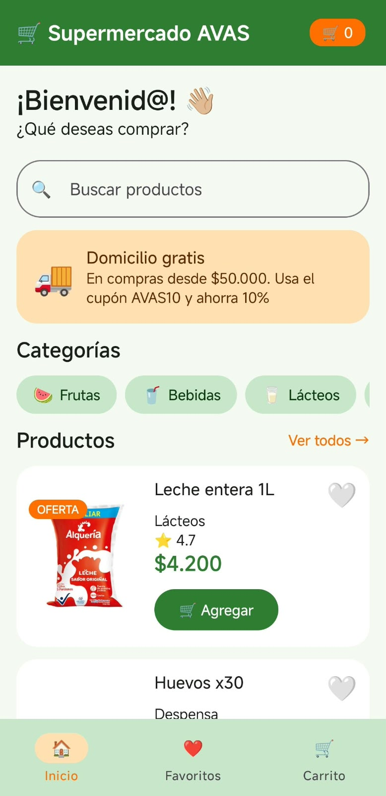
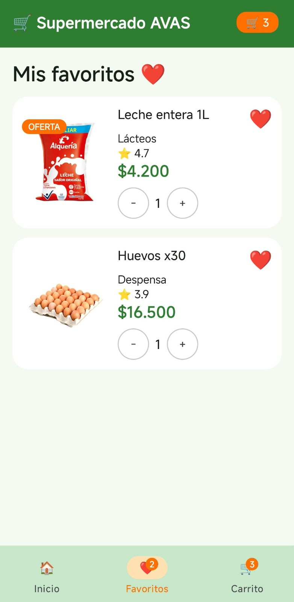
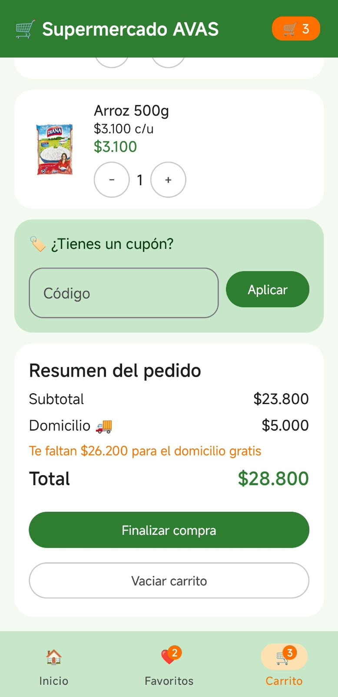

# 🛒 Supermercado AVAS

Aplicación móvil para Android desarrollada con **Kotlin** y **Jetpack Compose** como proyecto de la asignatura Desarrollo de Aplicaciones Moviles.

## 📌 Descripción del negocio

**Supermercado AVAS** es un supermercado que ofrece productos de consumo diario: lácteos, frutas, granos, bebidas, panadería y productos de despensa. Su identidad visual se basa en el **verde** y el **naranja** (ofertas y acciones importantes), con tarjetas redondeadas, fotos de productos y un banner de domicilio gratis.

## 🎯 Objetivo de la aplicación

Permitir que el cliente pueda buscar productos, guardar sus favoritos y armar su pedido, viendo en todo momento cuánto va a pagar, incluyendo el costo del domicilio y los descuentos por cupón.

## 📸 Capturas de pantalla

| Inicio | Favoritos | Carrito |
|:---:|:---:|:---:|
|  |  |  |

## 📱 Pantallas implementadas

La navegación se hace con Navigation Compose (`NavController` + `NavHost`) mediante una barra inferior con tres destinos:

1. **Inicio**: saludo de bienvenida, buscador, banner de domicilio gratis, categorías filtrables y lista de productos con etiqueta de OFERTA, calificación, precio y botón para agregar.
2. **Favoritos**: muestra únicamente los productos marcados con corazón y permite agregarlos al carrito desde ahí. Si no hay favoritos, muestra un mensaje vacío.
3. **Carrito**: lista de productos agregados con control de cantidades, campo de cupón, resumen del pedido (subtotal, descuento, domicilio y total) y botones para finalizar la compra o vaciar el carrito.

## ⚙️ Funcionalidades

### 1️⃣ Trabajada en clase: búsqueda, filtrado y cantidades

- **Buscador** de productos por nombre: la lista se actualiza al instante.
- **Agregar al carrito** y ajustar cantidades con los botones `-` y `+`.
- El contador del carrito (barra superior e inferior) se actualiza automáticamente.
- Como extra, las **categorías** son seleccionables para filtrar los productos; al tocarlas de nuevo se vuelve a ver todo.

### 2️⃣ Nueva: Favoritos ❤️

- Cada producto tiene un corazón que se marca y desmarca.
- La pantalla **Favoritos** muestra solo los productos marcados, y el ícono de la barra inferior muestra una insignia con la cantidad.
- Ambas pantallas comparten el mismo estado, por lo que siempre están sincronizadas.

### 3️⃣ Nueva: Total con cupón y domicilio 🏷️🚚

- Cálculo automático de subtotal, descuento y total del pedido.
- Cupón `AVAS10`: aplica un 10 % de descuento. Si el código no es válido, se muestra un error.
- Domicilio: cuesta $5.000, pero es gratis desde $50.000; la app indica cuánto falta para lograrlo.
- Al presionar Finalizar compra aparece un mensaje con el valor pagado y el carrito queda vacío.

## ▶️ Instrucciones para ejecutar el proyecto

**Requisitos:** Android Studio (versión reciente) y un emulador o dispositivo Android.

1. Clona el repositorio:
```bash
   git clone https://github.com/alecsandravalencia/Supermercado-AVAS.git
```
2. Abre la carpeta del proyecto con **Android Studio**.
3. Espera a que **Gradle** sincronice las dependencias.
4. Selecciona un emulador o conecta un dispositivo con la depuración USB activada.
5. Presiona **Run ▶** para compilar e instalar la app.

## 👤 Autora

**Alecsandra Valencia** — Asignatura Desarrollo de Aplicaciones Móviles
