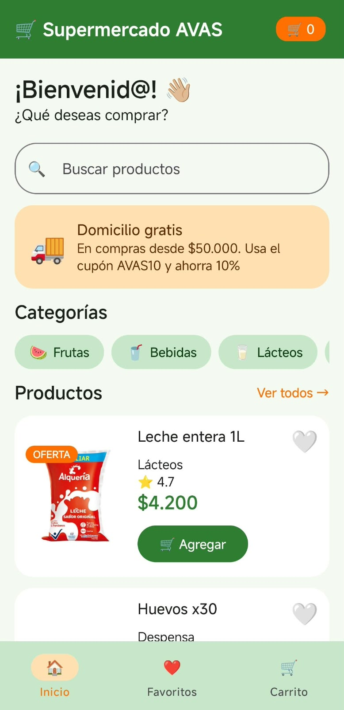
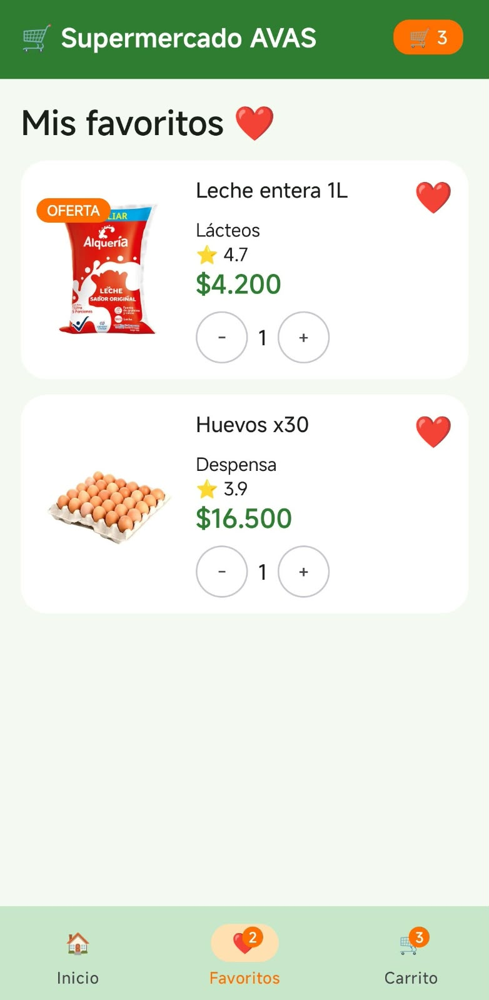
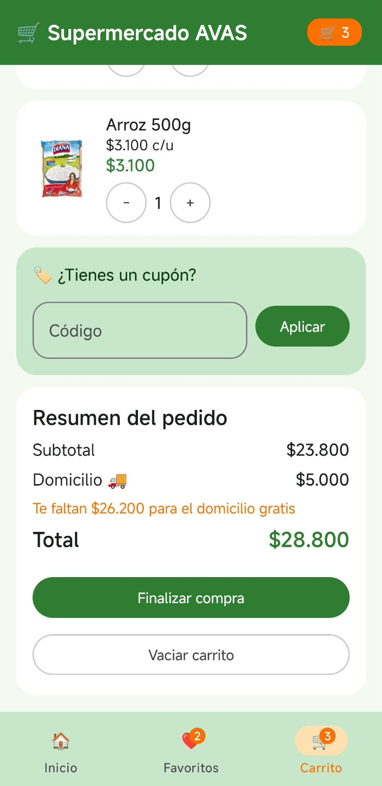

# 🛒 Supermercado AVAS

Aplicación móvil para Android desarrollada con **Kotlin** y **Jetpack Compose** como proyecto de la asignatura Desarrollo de Aplicaciones Moviles.

## 📌 Descripción del negocio

**Supermercado AVAS** es un supermercado que ofrece productos de consumo diario: lácteos, frutas, granos, bebidas, panadería y productos de despensa. Su identidad visual se basa en el **verde** y el **naranja** (ofertas y acciones importantes), con tarjetas redondeadas, fotos de productos y un banner de domicilio gratis.

## 🎯 Objetivo de la aplicación

Permitir que el cliente pueda buscar productos, guardar sus favoritos y armar su pedido, viendo en todo momento cuánto va a pagar, incluyendo el costo del domicilio y los descuentos por cupón. Además, el negocio puede administrar su catálogo y sus cupones, y consultar el historial de pedidos.

## 📸 Capturas de pantalla

| Inicio | Favoritos | Carrito |
|:---:|:---:|:---:|
|  |  |  |

## 🏗️ Arquitectura y estructura del proyecto
```
com.example.miprimeraaplicacion
├── data
│   ├── local          Entidades, DAOs y SupermercadoDatabase (Room)
│   └── repository     SupermercadoRepository
├── viewmodel          SupermercadoViewModel (StateFlow) y su Factory
├── ui
│   ├── components     Componentes reutilizables (tarjetas, selector de cantidad...)
│   └── screens        Pantallas Compose
├── util               Constantes y cálculo de totales
└── MainActivity.kt    Configuración de Room y navegación (NavHost)
```

**Flujo de datos:** Pantalla (Compose) → ViewModel → Repository → DAO → Room. La base de datos expone los datos con Flow, el ViewModel los convierte en StateFlow y las pantallas se actualizan solas al recolectarlos con collectAsStateWithLifecycle.

## 🗄️ Base de datos Room
Base de datos supermercado_database con 5 entidades relacionadas:

| Entidad | Descripción | Relación |
|---|---|---|
| `CategoryEntity` | Categorías de productos (nombre y emoji) | 1 categoría → N productos |
| `ProductEntity` | Productos con precio, oferta, favorito y cantidad en el carrito | `categoryId` → `CategoryEntity` (`@ForeignKey`) |
| `CouponEntity` | Cupones de descuento (código, porcentaje, activo) | Independiente |
| `OrderEntity` | Pedidos realizados (fecha, subtotal, descuento, domicilio, total) | 1 pedido → N ítems |
| `OrderItemEntity` | Productos comprados en cada pedido | `orderId` → `OrderEntity` (`@ForeignKey`) |

**DAOs:** ProductDao, CategoryDao, CouponDao y OrderDao, con consultas Flow y operaciones suspend.

**Relaciones de consulta:** ProductWithCategory y OrderWithItems (@Embedded + @Relation).

**CRUD** completo sobre productos y cupones.

**Datos iniciales:** categorías, productos de ejemplo y el cupón AVAS10 se cargan solo la primera vez que se crea la base de datos.

**Persistencia**: favoritos, carrito, productos, cupones y pedidos se guardan en Room y se conservan al cerrar y volver a abrir la aplicación.

**Transacción:** al finalizar la compra, el pedido, sus ítems y el vaciado del carrito se guardan en una sola transacción.

## 📱 Navegación
Navigation Compose (NavController + NavHost) con una barra inferior de cinco destinos y una pantalla adicional de formulario:

1. Inicio
2. Favoritos
3. Carrito
4. Pedidos
5. Gestión (pestañas Productos y Cupones)
6. Formulario de producto (se abre desde Gestión para registrar o editar)

## ⚙️ Funcionalidades

### 1️⃣ Trabajada en clase: búsqueda, filtrado y cantidades

- **Buscador** de productos por nombre: la lista se actualiza al instante.
- **Agregar al carrito** y ajustar cantidades con los botones `-` y `+`.
- El contador del carrito (barra superior e inferior) se actualiza automáticamente.
- Como extra, las **categorías** son seleccionables para filtrar los productos; al tocarlas de nuevo se vuelve a ver todo.

### 2️⃣ Nueva: Favoritos ❤️

- Cada producto tiene un corazón que se marca y desmarca.
- La pantalla **Favoritos** muestra solo los productos marcados, y el ícono de la barra inferior muestra una insignia con la cantidad.
- Ambas pantallas comparten el mismo estado, por lo que siempre están sincronizadas.

### 3️⃣ Nueva: Total con cupón y domicilio 🏷️🚚

- Cálculo automático de subtotal, descuento y total del pedido.
- Cupón `AVAS10`: aplica un 10 % de descuento. Si el código no es válido, se muestra un error.
- Domicilio: cuesta $5.000, pero es gratis desde $50.000; la app indica cuánto falta para lograrlo.
- Al presionar Finalizar compra aparece un mensaje con el valor pagado y el carrito queda vacío.

## ⚙️ Funcionalidades nuevas, segundo corte
### 1️⃣ Registro de productos (formulario)
**Ruta:** Gestión → Productos → ➕ Registrar producto. Completa el nombre, el precio y elige una categoría; opcionalmente escribe un emoji propio y marca si está en oferta. El formulario valida que el nombre no esté vacío, que el precio sea mayor a 0 y que se elija una categoría.
**Comprobar:** vuelve a Inicio, el producto aparece en el catálogo.

### 2️⃣ Consulta de productos y categorías almacenados
**Ruta:** Inicio y Gestión → Productos. Los productos y categorías se leen desde Room y se muestran con su precio, categoría, calificación y etiqueta de oferta.

### 3️⃣ Edición de productos
**Ruta:** Gestión → Productos → ✏️ Editar en un producto. Cambia el precio (o cualquier otro dato) y guarda.
**Comprobar:** el nuevo precio se ve en Inicio y en el carrito.

### 4️⃣ Eliminación de productos
**Ruta:** Gestión → Productos → 🗑️ Eliminar → confirmar en el diálogo.
**Comprobar:** el producto desaparece de Inicio, Favoritos y Carrito.

### 5️⃣ Cupones administrables desde la base de datos
**Ruta:** Gestión → Cupones. Crea un cupón (por ejemplo VERANO15 con 15 %), actívalo o desactívalo con el interruptor, o elimínalo. No permite códigos repetidos ni porcentajes fuera de 1–100.
**Comprobar:** en Carrito escribe el código y pulsa Aplicar: se aplica el descuento. Un cupón inactivo o inexistente muestra «Cupón no válido».

### 6️⃣ Historial de pedidos y estadísticas
**Ruta**: Carrito → Finalizar compra → pestaña Pedidos. Cada compra queda registrada con fecha, productos, cupón usado y total. En la parte superior se muestran estadísticas: pedidos realizados, total gastado, promedio por pedido y pedido más grande.

### 7️⃣ Favoritos y carrito persistentes
**Ruta:** Inicio → toca el ❤️ y 🛒 Agregar en varios productos.
**Comprobar la persistencia:** cierra la aplicación por completo, ábrela de nuevo y verifica que los favoritos y el carrito se conservan.

## ▶️ Instrucciones para ejecutar el proyecto

**Requisitos:** Android Studio (versión reciente) y un emulador o dispositivo Android.

1. Clona el repositorio:
```bash
   git clone https://github.com/alecsandravalencia/Supermercado-AVAS.git
```
2. Abre la carpeta del proyecto con **Android Studio**.
3. Espera a que **Gradle** sincronice las dependencias.
4. Selecciona un emulador o conecta un dispositivo con la depuración USB activada.
5. Presiona **Run ▶** para compilar e instalar la app.

## 📦 APK
El archivo .apk instalable se encuentra en:
```
https://github.com/alecsandravalencia/Supermercado-AVAS/releases/tag/V2.0
```

## 👤 Autora

**Alecsandra Valencia** — Asignatura Desarrollo de Aplicaciones Móviles
